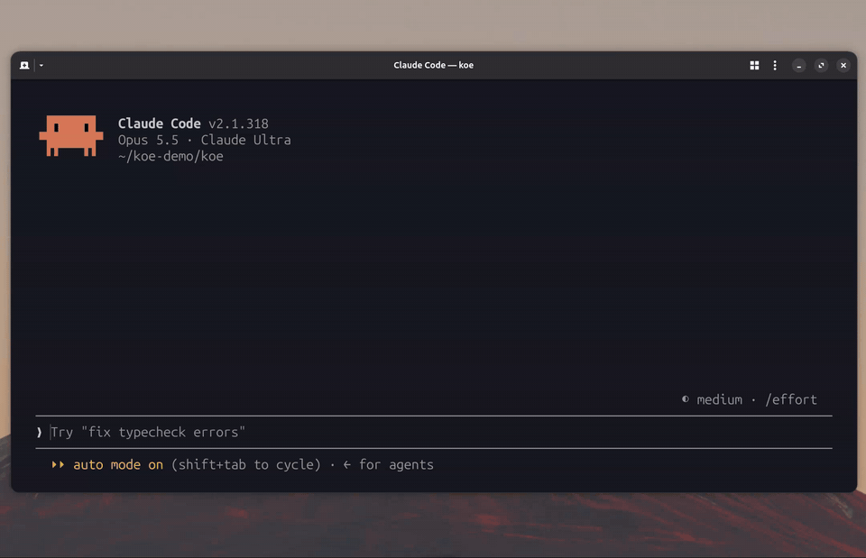

# Koe（声）

[](LICENSE)
[](https://www.rust-lang.org/)
[](https://ubuntu.com/)

**日本語** | [English](README.en.md)

**Ubuntu で使える、日本語のための AI 音声入力。**

> 🎤 ホットキーを押して話す → AI が文章に整える → 今のアプリに入力される



Mac や Windows には、話した内容を AI が読みやすい文章に整えてくれる音声入力ツールがいくつもあります。Ubuntu にはそれがありませんでした。Koe は、作者が Ubuntu で毎日使っている日本語の音声入力です。作った経緯や、GNOME Wayland で動かすための工夫は、Zenn の記事「[Ubuntu には「話すと文章になる」音声入力がなかったので作りました](https://zenn.dev/sal9000/articles/koe-ubuntu-voice-input)」に書きました。

- **Ubuntu 26.04（GNOME Wayland）で動く** — 標準のデスクトップポータルを使い、ショートカットも文字入力も Wayland でそのまま動きます
- **日本語が前提** — 標準の認識言語は日本語。日本語や複数行のテキストも、入力欄に崩れずに入ります
- **AI が文章に整える** — 認識の誤りを直し、句読点を補い、技術用語を正しい表記に直します（Claude / Ollama）
- **使うほど賢くなる** — 直した用語や文脈を AI が覚え、次の認識と整形に活かします
- **全部ローカルでも動く** — whisper.cpp + Ollama なら、音声も文字もマシンの外に出ません

## こんな使い方を想定しています

- **Claude Code やチャットに、声で指示を出す。** 長い依頼や背景説明をキーボードで打つより、話したほうが早い場面で
- **Slack やドキュメントに、整った文章を入れる。** 話し言葉のまま入るのではなく、句読点の入った書き言葉になって入ります
- **技術用語の多い話をそのまま入力する。** 「ラスト」→「Rust」、「ウブンツ」→「Ubuntu」のような直しを辞書と学習メモリで行います

## 機能

| 機能 | 内容 |
|---|---|
| 音声認識 | whisper.cpp（ローカル、Vulkan で GPU 利用）か OpenAI の文字起こし API（`gpt-transcribe`） |
| AI による整形 | Claude API か Ollama（ローカル LLM）。認識の誤りの修正、句読点、辞書に沿った表記 |
| 学習メモリ | AI が用語や文脈を覚え、Whisper へのヒントと整形の両方に使う（Claude 使用時） |
| 用語辞書 | TOML で「誤認識 → 正しい表記」を宣言しておける |
| 無音の除去（VAD） | Silero VAD で無音を落とし、何も話していないのに「ご視聴ありがとうございました」と入力される現象を防ぐ |
| ライブ文字起こし | 録音中に、そこまでの認識結果をオーバーレイに表示（ローカル認識のみ） |
| ホットキー | 押している間だけ録音（プッシュ・トゥ・トーク）か、押すたびに開始/停止（トグル） |
| 入力 | アクティブなウィンドウに直接入力。Wayland では日本語・複数行をクリップボード経由で貼り付け |
| 履歴 | 認識結果と整形結果を保存し、設定画面から見返せる |
| 設定画面 | GTK4 / libadwaita の設定画面（`koe settings`）とトレイアイコン |
| 録音中の表示 | GNOME Shell 拡張で、入力先のフォーカスを奪わずに録音状態を表示 |

## 動作環境

- **Ubuntu 26.04 / GNOME（Wayland）/ x86_64** — 作者が毎日使っている、いちばん確かめられている環境です
- X11 セッションでも動きます。アクティブウィンドウの情報を AI に渡す機能は X11 のみです
- それ以外のディストリビューションやデスクトップ環境は、動くかもしれませんが確認していません

## インストール

### .deb パッケージ（おすすめ）

[Releases](https://github.com/shuhei0866/koe/releases) から最新の `koe_X.Y.Z-1_amd64.deb` をダウンロードして入れます。必要なライブラリも一緒に入ります。

```bash
sudo apt install ./koe_*_amd64.deb
```

desktop ファイル（Wayland でポータルが Koe を識別するのに使います）、systemd のユーザーユニット、辞書、GNOME Shell 拡張も入ります。設定ファイルは初回起動時に `~/.config/koe/config.toml` に作られます。消すときは `sudo apt remove koe` です（自分の設定・履歴・モデルは `~` に残ります）。

続けて「[モデルのダウンロード](#モデルのダウンロード)」へ進みます。

### ビルド済みバイナリ（tar.gz）

[Releases](https://github.com/shuhei0866/koe/releases) から最新の `koe-vX.Y.Z-linux-x86_64.tar.gz` をダウンロードして展開し、`koe` を `$PATH` の通った場所（例: `~/.local/bin/`）に置きます。設定ファイルは、リポジトリの `config.toml` を `~/.config/koe/config.toml` にコピーして使ってください。

Wayland では、デスクトップポータルが Koe を識別するために desktop ファイルが必要です。起動する前に、アーカイブを展開したディレクトリで次を実行してください。

```bash
desktop-file-install --dir="$HOME/.local/share/applications" \
  --set-key=Exec --set-value="$(command -v koe)" io.github.shuhei0866.koe.desktop
```

続けて「[モデルのダウンロード](#モデルのダウンロード)」へ進みます。

### ソースからビルド

```bash
sudo apt install -y libasound2-dev libclang-dev libxkbcommon-dev \
  libx11-dev libxi-dev libxext-dev libxtst-dev libxfixes-dev cmake \
  libgtk-4-dev libadwaita-1-dev libvulkan-dev glslc

cargo build --release

desktop-file-install --dir="$HOME/.local/share/applications" \
  --set-key=Exec --set-value="$(pwd)/target/release/koe" data/io.github.shuhei0866.koe.desktop
```

### モデルのダウンロード

Whisper のモデル（ローカル認識に使います）:

```bash
mkdir -p ~/.local/share/koe/models
wget -O ~/.local/share/koe/models/ggml-large-v3.bin \
  https://huggingface.co/ggerganov/whisper.cpp/resolve/main/ggml-large-v3.bin
```

VAD のモデル（推奨）。ないと、無音の録音から Whisper が話していない文を作ってしまうことがあります。モデルがなければ警告を出して、録音全体をそのまま認識します。

```bash
wget -O ~/.local/share/koe/models/ggml-silero-v5.1.2.bin \
  https://huggingface.co/ggml-org/whisper-vad/resolve/main/ggml-silero-v5.1.2.bin
```

### API キー

使うサービスの分だけ設定します。完全ローカル構成（whisper.cpp + Ollama）なら不要です。

おすすめは GNOME キーリングに入れる方法です。ターミナルから起動しても、systemd のユーザーユニットから自動起動しても読めます。コマンドを実行するとキーの入力を求められます。

```bash
secret-tool store --label "koe anthropic-api-key" service koe key anthropic-api-key   # AI の整形に Claude を使う場合
secret-tool store --label "koe openai-api-key" service koe key openai-api-key         # 音声認識に OpenAI API を使う場合
```

環境変数でも渡せます。ただしシェルで `export` した値は、ユーザーユニットから起動した Koe には届きません。ユーザーユニットで使う場合は、`~/.config/koe/env` に `ANTHROPIC_API_KEY=...` の形で書いてください（`chmod 600` 推奨）。

```bash
export ANTHROPIC_API_KEY="..."   # ターミナルから koe を起動する場合
export OPENAI_API_KEY="..."
```

## 初回起動（GNOME Wayland）

```bash
koe                    # .deb で入れた場合、ビルド済みバイナリを $PATH に置いた場合
./target/release/koe   # ソースからビルドした場合（リポジトリ直下で実行すると同梱の config.toml を使う）
```

.deb で入れた場合は、ログイン時に自動で起動するようにもできます（モデルをダウンロードしてから有効にしてください）。

```bash
systemctl --user enable --now koe
```

Koe は GNOME 標準のデスクトップポータル（GlobalShortcuts / RemoteDesktop / Clipboard）を使います。

1. 画面のロックを解除した状態で起動します
2. 「キーボードの操作」と「クリップボードへのアクセス」を許可します
3. 音声入力のショートカットを登録するダイアログで許可します

Koe が求めるのはキーボードとクリップボードだけで、画面やポインターへのアクセスは求めません。もともとクリップボードにあった内容を読むこともありません。許可はセッションごとなので、Koe を再起動するとまた聞かれます。許可を断ったり取り消したりした場合は、Koe を再起動するまで音声入力は止まります（ダイアログを繰り返し出したり、X11 の方式に切り替えたりはしません）。

### 使い方のコツ

- 話している間は、入力したい欄にフォーカスを置いたままにしてください
- 日本語と複数行のテキストはクリップボード経由で貼り付けます。貼り付け後、クリップボードの中身は認識結果に置き換わります
- 貼り付けのキーは、入力先に合わせて自動で切り替わります。ターミナル（Ptyxis、GNOME Terminal、Ghostty、kitty など）には Ctrl+Shift+V、それ以外のアプリには Ctrl+V を送ります。自動で切り替えるには、下の GNOME Shell 拡張が必要です。拡張がないときは Ctrl+V になります
- 一覧にないターミナルでは Ctrl+V が送られ、貼り付けられないことがあります。その場合は `ctrl_shift_v` に固定するか、Issue で教えてください
- どちらかに固定したい場合は、`config.toml` で指定します

```toml
[input]
wayland_paste_shortcut = "auto"   # 固定するなら "ctrl_v" か "ctrl_shift_v"
```

Wayland では、Koe 本体は入力先のウィンドウを調べられません。そのため、ターミナルかどうかの判定は GNOME Shell 拡張が行い、フォーカス中のアプリの種類（WM_CLASS）だけを Koe に伝えます。ウィンドウのタイトルは渡しません。アクティブウィンドウの情報を AI に渡す機能は、Wayland では使えません。また入力先のフォーカスを奪わないよう、Koe 自身のフローティング表示は出しません（音と履歴は使えます）。録音状態を画面に出したい場合は、次の GNOME Shell 拡張を入れてください。

### 録音中の表示（GNOME Shell 拡張）

GNOME Shell 50 向けの拡張を同梱しています。Koe が D-Bus で送る状態を受け取り、Shell の中にオーバーレイを描くので、入力先のフォーカスを奪いません。入力先がターミナルかどうかを判定して、貼り付けのキーを切り替えるのも、この拡張の役目です。

.deb で入れた場合は拡張もインストール済みです。一度ログアウトして入り直してから（GNOME の Wayland では、新しい拡張はログイン時に読み込まれます）、有効にします。

```bash
gnome-extensions enable koe-overlay@shuhei0866.github.io
```

ソースや tar.gz から入れた場合は、リポジトリの次のスクリプトで自分のホームに入れてから、ログアウトして入り直してください。外すときは `gnome-extensions uninstall koe-overlay@shuhei0866.github.io` です。

```bash
./gnome-extension/install.sh
```

## 設定（`~/.config/koe/config.toml`）

設定画面（`koe settings`）からも変更できます。

```toml
[recognition]
engine = "whisper_local"  # "whisper_local" | "openai_api"

[recognition.whisper_local]
model_path = "~/.local/share/koe/models/ggml-large-v3.bin"
language = "ja"

[recognition.openai_api]
api_key_env = "OPENAI_API_KEY"
language = "ja"
model = "gpt-transcribe"  # whisper-1 は 2027-02-26 に使えなくなります

[ai]
engine = "claude"  # "claude" | "ollama"

[ai.claude]
api_key_env = "ANTHROPIC_API_KEY"
model = "claude-sonnet-5-5"

[ai.ollama]
host = "http://localhost:11434"
model = "qwen2.5:14b"

[hotkey]
mode = "push_to_talk"  # "push_to_talk" | "toggle"
key = "Super_R"

[dictionaries]
paths = ["dictionaries/default.toml"]

# 以下は省略可能（書いてある値が既定値）
[memory]
enabled = true
dir = "~/.local/share/koe/memory"

[history]
enabled = true
dir = "~/.local/share/koe/history"

[vad]
enabled = true
model_path = "~/.local/share/koe/models/ggml-silero-v5.1.2.bin"
threshold = 0.5       # 音声とみなす確率（0.0〜1.0）。雑音が残るなら上げる
min_speech_ms = 250   # これより短い音は雑音として捨てる
speech_pad_ms = 200   # 音声の前後に残す余白

[live]
enabled = true     # 録音中のライブ文字起こし（ローカル認識のみ）
interval_ms = 700  # ライブ文字起こしの間隔
```

録音開始の合図の音がマイクに入ることがあります。`[feedback] sound_enabled` が有効で VAD のモデルがあるときは、録音開始から 0.6 秒以内に終わる音を無視します（VAD がないときは除けません）。各録音のうちどれだけを音声として残したかは、ログの `VAD: kept` で確認できます。

ライブ文字起こしは、話の切れ目ごとにそこまでの録音（最大で直近 25 秒）を認識し直し、D-Bus の `LiveTranscript` シグナルで送ります。リクエストごとに課金される `openai_api` では使いません。録音を止めると、実行中のライブ認識を待ってから録音全体をもう一度認識し、その結果を入力します。

## 用語辞書

`dictionaries/default.toml`:

```toml
[terms]
"ラスト" = "Rust"
"クロード" = "Claude"
"ウブンツ" = "Ubuntu"

[context_hints]
domain = "software development"
notes = "Prefer English for programming language and tool names"
```

`[terms]` は認識結果にそのまま適用される置き換えです。`[context_hints]` は AI に渡す補足で、分野や表記の方針を書いておけます。

## 学習メモリ

AI の整形に Claude を使っていると、Koe は覚えておく価値のある用語や文脈を AI に記録させます（`~/.local/share/koe/memory`）。覚えた用語は次の録音から Whisper へのヒントとして渡され、文脈は整形のときに使われます。記録が 50 件に達すると、AI が重複をまとめて整理します。

使いたくない場合は `[memory] enabled = false` にしてください。

## プライバシー

どのデータが外に出るかは、組み合わせ次第です。

| 構成 | 外部に送るもの | 手元に残るもの |
|---|---|---|
| **whisper.cpp + Ollama**（完全ローカル） | なし | 音声、認識結果、ウィンドウ情報、すべての処理 |
| **OpenAI API + Ollama** | 音声（OpenAI へ、文字起こしのため） | ウィンドウ情報、整形 |
| **whisper.cpp + Claude API** | 認識結果とアクティブウィンドウのタイトル・アプリ名（Anthropic へ） | 音声 |
| **OpenAI API + Claude API** | 音声（OpenAI へ）、認識結果とウィンドウ情報（Anthropic へ） | — |

**ウィンドウ情報について:** Claude API を使う場合、認識結果と一緒にアクティブウィンドウのタイトルとアプリ名を送ります（X11 のみ）。ウィンドウタイトルにはファイルパスや URL、メールの件名などが含まれることがあります。送りたくない場合は `koe --no-context` で起動するか、完全ローカル構成を使ってください。

## トラブルシューティング（GNOME Wayland）

デスクトップポータルは、アプリが話しかける `xdg-desktop-portal` と、ダイアログを出したりショートカットの押下を届けたりする GNOME 側の `xdg-desktop-portal-gnome` の2つで動いています。トラブルの多くは、この2つの足並みがずれることで起きます。

| 症状（`journalctl --user -u koe`） | 対処 |
|---|---|
| `Wayland voice input disconnected: ... reconnecting` が出て、予期しない許可ダイアログが出る | GNOME が Koe の入力セッションを閉じました。Koe が自分で再接続するので、ダイアログを許可してください |
| `Wayland voice shortcut ready` と出ているのに、キーを押しても反応しない | ポータルの2つのサービスをまとめて再起動し、そのあと Koe を再起動します（下記） |
| `Invalid state` や `Portal request didn't succeed with no information` | GNOME 側のサービスが落ちたか古い状態です。ポータルの2つのサービスを再起動し、そのあと Koe を再起動します |
| `Portal request was cancelled` / `gave up after ... reconnection attempts` | ダイアログを繰り返し出さないよう、Koe が再試行をやめました。Koe を再起動してください |

ポータルの2つのサービスをまとめて再起動し、Koe を再起動して、ダイアログを許可します。

```bash
systemctl --user restart xdg-desktop-portal-gnome xdg-desktop-portal
systemctl --user restart koe   # systemd のユーザーユニットで動かしている場合
```

ユーザーユニットを使っていない場合は、Koe を終了してから `koe` で起動し直してください。

`xdg-desktop-portal` だけを再起動しないでください。GNOME 側が古いほうにショートカットの押下を送り続けるため、登録は成功するのにキーの押下が Koe に届かなくなります。

キーの押下がどこで止まっているかは、音声入力のキーを押しながら両端を見ると分かります。

```bash
keyd monitor   # keyd でキーを割り当て直している場合のみ。割り当て後のキーが出ているか
dbus-monitor --session "type='signal',interface='org.freedesktop.portal.GlobalShortcuts'"   # GNOME が Activated を送っているか
```

GNOME が Koe 用に保存しているショートカットは `dconf dump /org/gnome/settings-daemon/global-shortcuts/` で確認できます。

## 仕組み

```
[ホットキー] → [録音 (cpal)] → [VAD (Silero)] → [音声認識] → [辞書の置き換え] → [AI による整形] → [入力]
                                                    ↑                                  ↑
                                          whisper.cpp / OpenAI                Claude / Ollama
                                                                                       ↑
                                                                         [学習メモリ・ウィンドウ情報]
```

処理の流れと状態遷移の図、モジュール構成は [英語版 README](README.en.md#processing-flow) にあります。

## 開発に参加する

[CONTRIBUTING.md](CONTRIBUTING.md) を読んでください。Issue や PR は日本語で大丈夫です。

## ライセンス

[MIT](LICENSE)
