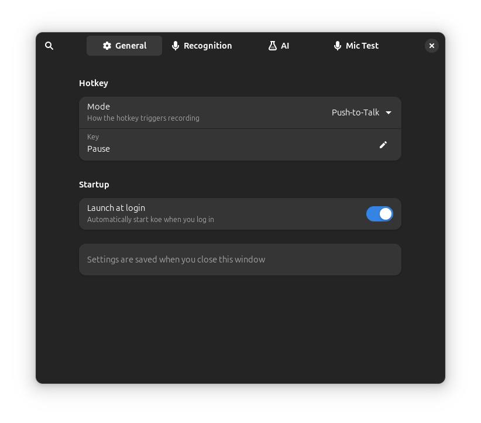
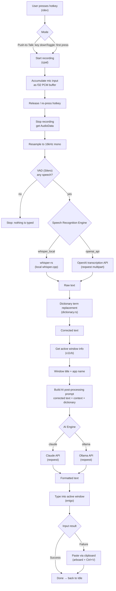
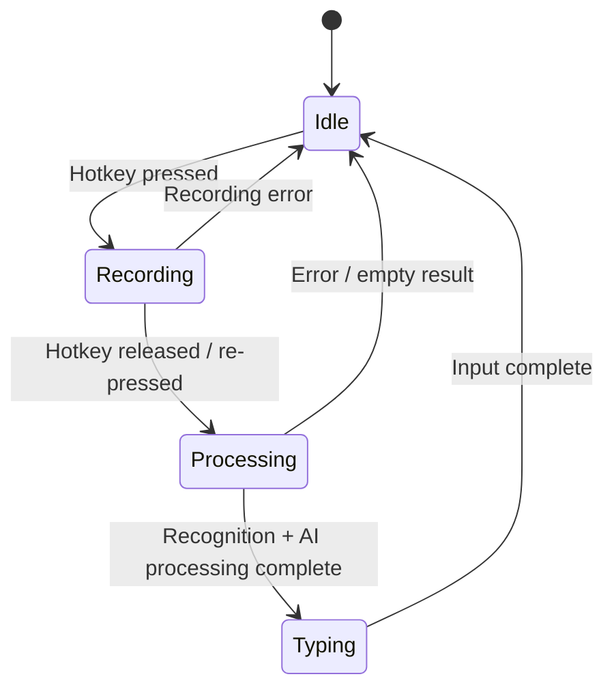

# koe

[](LICENSE)
[](https://www.rust-lang.org/)
[](https://www.linux.org/)

**The voice input tool Linux has been missing — AI-powered and open source.**

> 🎤 Press hotkey → Speak → AI formats → Text appears in your app




## Why koe?

macOS has polished voice input tools with AI post-processing, but Linux has had no equivalent — just raw STT with no intelligence behind it.

**koe** fills that gap:

- **AI post-processing** — raw transcription is refined by an LLM that understands your context
- **Context-aware** — reads the active window title/app to tailor output (code comments in an editor, natural prose in a doc)
- **Fully local option** — whisper.cpp + Ollama means zero data leaves your machine
- **Built in Rust** — single binary, low latency, minimal resource usage
- **Dictionary support** — domain-specific term correction for accurate technical vocabulary

## Feature Comparison

| Feature | **koe** | nerd-dictation | Google Docs Voice | No voice input |
|---|---|---|---|---|
| AI post-processing | Yes (Claude / Ollama) | No | No | — |
| Context-aware formatting | Yes (active window) | No | No | — |
| Fully local operation | Yes (whisper.cpp + Ollama) | Yes | No | — |
| Custom dictionary | Yes (declarative TOML + AI-aware) | Yes (Python scripting) | No | — |
| Hotkey modes | Push-to-talk + Toggle | Push-to-talk | Button | — |
| Direct typing to any app | Yes | Yes | Google Docs only | — |
| Language | Any (Whisper) | Any (Vosk) | Many | — |

## Features

- **Speech Recognition**: Switch between whisper.cpp (local) and OpenAI transcription API (cloud, `gpt-transcribe` by default)
- **AI Post-Processing**: Switch between Claude API and Ollama (local LLM)
- **Context Awareness**: Active window info is sent to the AI for context-appropriate formatting
- **Dictionary Management**: Domain-specific term dictionaries improve recognition accuracy
- **Silence Removal (VAD)**: Silero VAD drops silence before recognition, so silent recordings type nothing instead of hallucinated sentences
- **Live Transcript**: While recording, the overlay shows what has been recognized so far (local whisper.cpp only). Only the final text is typed
- **Hotkeys**: Push-to-talk and toggle modes with configurable key bindings
- **Direct Input**: Types directly into the active window, with clipboard fallback

## Processing Flow



## State Machine



## Architecture

```
[Hotkey (rdev)] → [Audio Capture (cpal)] → [Speech Recognition] → [AI Post-Processing] → [Text Input (enigo)]
                                                    ↑                      ↑
                                            whisper-rs / OpenAI     Claude / Ollama
                                                                          ↑
                                                              [Context Capture (x11rb)]
                                                              [Dictionary Manager]
```

## Modules

| File | Role |
|------|------|
| `src/main.rs` | Event loop, state management (Idle → Recording → Processing → Typing) |
| `src/config.rs` | TOML config file loading |
| `src/audio.rs` | Mic recording via cpal, 16kHz resampling, WAV encoding |
| `src/recognition/whisper_local.rs` | Local speech recognition via whisper-rs |
| `src/recognition/openai_api.rs` | Speech recognition via OpenAI transcription API (`gpt-transcribe`, `whisper-1`, ...) |
| `src/ai/claude.rs` | Text post-processing via Claude API |
| `src/ai/ollama.rs` | Text post-processing via Ollama |
| `src/context.rs` | Active window title/class capture via x11rb |
| `src/input.rs` | Direct typing via enigo + clipboard paste fallback |
| `src/hotkey.rs` | Global hotkey via rdev (Push-to-Talk / Toggle) |
| `src/dictionary.rs` | TOML dictionary loading and term replacement |

## Setup

### Pre-built Binary

Download the latest pre-built binary from the [Releases page](https://github.com/shuhei0866/koe/releases).
Extract and place the `koe` binary in your `$PATH` (e.g. `~/.local/bin/`). On Wayland, also install the included desktop identity before starting Koe:

```bash
desktop-file-install --dir="$HOME/.local/share/applications" \
  --set-key=Exec --set-value="$(command -v koe)" io.github.shuhei0866.koe.desktop
```

Then skip to [Download Whisper Model](#download-whisper-model).

### Build from Source

#### Dependencies

```bash
sudo apt install -y libasound2-dev libclang-dev libxkbcommon-dev \
  libx11-dev libxi-dev libxext-dev libxtst-dev libxfixes-dev cmake \
  libgtk-4-dev libadwaita-1-dev libvulkan-dev glslc
```

### GNOME Wayland (Ubuntu 26.04)

Koe uses the standard GlobalShortcuts and RemoteDesktop/Clipboard portals. Unlock the desktop before the first authorization. At startup, approve keyboard control and clipboard access, then the dictation shortcut, in the desktop dialogs. Koe requests no screen or pointer access and never reads existing clipboard contents. Permission is session-only; restarting Koe asks again. X11 continues to use its existing input backend.

When building from source, install the desktop identity first:

```bash
desktop-file-install --dir="$HOME/.local/share/applications" \
  --set-key=Exec --set-value="$(pwd)/target/release/koe" data/io.github.shuhei0866.koe.desktop
```

Keep the intended text field focused while dictating. Japanese and multiline text are pasted through the clipboard; the transcript replaces the clipboard contents. The default paste shortcut is Ctrl+V. For terminal applications that require Ctrl+Shift+V, set this in `config.toml`:

```toml
[input]
wayland_paste_shortcut = "ctrl_shift_v"
```

Use `"ctrl_v"` for GUI applications. Automatic terminal detection and active-window context are unavailable on Wayland. Koe's own floating indicator window is disabled to preserve the target's focus; sound feedback and history remain available. Declining or revoking a portal permission stops voice input until an explicit Koe restart, without repeated prompts or an X11 fallback.

#### Recording overlay (GNOME Shell extension)

To see the recording state on screen under Wayland, install the bundled GNOME Shell extension (GNOME Shell 50). It listens to Koe's D-Bus state signals and draws the overlay inside the Shell, so it never takes focus from the window you are dictating into.

```bash
./gnome-extension/install.sh
```

Then log out and back in (GNOME on Wayland only loads new extensions at login). To remove it, run `gnome-extensions uninstall koe-overlay@shuhei0866.github.io`.

#### Troubleshooting (GNOME Wayland)

The desktop portal is two cooperating services: `xdg-desktop-portal` (the front end apps talk to) and `xdg-desktop-portal-gnome` (the GNOME back end that shows dialogs and delivers shortcut presses). Most problems come from the two getting out of sync.

| Symptom (`journalctl --user -u koe`) | What to do |
|---|---|
| `Wayland voice input disconnected: ... reconnecting` and a permission dialog appears unexpectedly | GNOME closed Koe's input session. Koe reconnects on its own; approve the dialog. |
| Log says `Wayland voice shortcut ready`, but pressing the key does nothing | Restart both portal services together, then Koe (see below). |
| `Invalid state` or `Portal request didn't succeed with no information` | The GNOME back end crashed or is stale. Restart both portal services, then Koe. |
| `Portal request was cancelled` / `gave up after ... reconnection attempts` | Koe stopped retrying to avoid repeated dialogs. Restart Koe. |

Restart both portal services together, then Koe, and approve the dialogs:

```bash
systemctl --user restart xdg-desktop-portal-gnome xdg-desktop-portal
systemctl --user restart koe
```

Never restart `xdg-desktop-portal` alone: the GNOME back end keeps sending shortcut presses to the old front end, so registration still succeeds but key presses never reach Koe.

To find where a key press stops, watch both ends while pressing the dictation key:

```bash
keyd monitor   # only if you remap keys with keyd: is the remapped key emitted?
dbus-monitor --session "type='signal',interface='org.freedesktop.portal.GlobalShortcuts'"   # does GNOME send Activated?
```

The binding GNOME stores for Koe is visible with `dconf dump /org/gnome/settings-daemon/global-shortcuts/`.

### Download Whisper Model

```bash
mkdir -p ~/.local/share/koe/models
wget -O ~/.local/share/koe/models/ggml-large-v3.bin \
  https://huggingface.co/ggerganov/whisper.cpp/resolve/main/ggml-large-v3.bin
```

### Download VAD Model (recommended)

Koe drops silence with Silero VAD before recognition. Without this, Whisper may type sentences that were never said (e.g. 「ご視聴ありがとうございました」) for silent recordings. If the model is missing, Koe logs a warning and transcribes whole recordings as before.

```bash
wget -O ~/.local/share/koe/models/ggml-silero-v5.1.2.bin \
  https://huggingface.co/ggml-org/whisper-vad/resolve/main/ggml-silero-v5.1.2.bin
```

### API Keys

```bash
# If using Claude for AI post-processing
export ANTHROPIC_API_KEY="your-key-here"

# If using OpenAI transcription API for recognition
export OPENAI_API_KEY="your-key-here"
```

#### Build & Run

```bash
cargo build --release
./target/release/koe
```

## Configuration (config.toml)

```toml
[recognition]
engine = "whisper_local"  # "whisper_local" | "openai_api"

[recognition.whisper_local]
model_path = "~/.local/share/koe/models/ggml-large-v3.bin"
language = "ja"

[recognition.openai_api]
api_key_env = "OPENAI_API_KEY"
language = "ja"
model = "gpt-transcribe"  # whisper-1 stops working on 2027-02-26

[ai]
engine = "claude"  # "claude" | "ollama"

[ai.claude]
api_key_env = "ANTHROPIC_API_KEY"
model = "claude-sonnet-5-5"

[ai.ollama]
host = "http://localhost:11434"
model = "qwen2.5:14b"

[hotkey]
mode = "push_to_talk"  # "push_to_talk" | "toggle"
key = "Super_R"

[dictionaries]
paths = ["dictionaries/default.toml"]

# Optional. These are the defaults.
[vad]
enabled = true
model_path = "~/.local/share/koe/models/ggml-silero-v5.1.2.bin"
threshold = 0.5       # speech probability (0.0-1.0); raise it if noise is kept
min_speech_ms = 250   # shorter sounds are treated as noise
speech_pad_ms = 200   # kept around each speech segment

# Optional. These are the defaults.
[live]
enabled = true     # live transcript in the overlay (local recognition only)
interval_ms = 700  # pause between live transcriptions
```

The start cue sound can be picked up by the microphone. While `[feedback] sound_enabled` is on and the VAD model is loaded, sounds that end within 0.6 s of the start of a recording are ignored (without VAD, the cue is not filtered). The `VAD: kept` log line shows how much of each recording was kept as speech.

The live transcript re-transcribes the recording so far (the last 25 s at most) after each pause, and sends it as the `LiveTranscript` D-Bus signal. It is not used with `openai_api`, which bills every request. When the recording stops, Koe waits for a live pass in progress to finish, then transcribes the whole recording once more for the text that is typed.

## Dictionary File

`dictionaries/default.toml`:

```toml
[terms]
"ラスト" = "Rust"
"クロード" = "Claude"
"ウブンツ" = "Ubuntu"

[context_hints]
domain = "software development"
notes = "Prefer English for programming language and tool names"
```

## Tech Stack

| Function | Crate |
|----------|-------|
| Audio recording | `cpal` |
| Local speech recognition | `whisper-rs` (whisper.cpp bindings) |
| Global hotkey | `rdev` |
| Keyboard input | `enigo` |
| X11 window info | `x11rb` |
| Clipboard | `arboard` |
| HTTP client | `reqwest` (rustls) |
| Async runtime | `tokio` |
| Config file | `serde` + `toml` |
| Logging | `tracing` |

## Privacy

koe's behavior depends on your configuration. Here's what data goes where:

| Configuration | Data sent externally | Data stays local |
|---|---|---|
| **whisper-rs + Ollama** (fully local) | Nothing | Audio, transcription, window context, all processing |
| **OpenAI transcription API + Ollama** | Audio (to OpenAI for STT) | Window context, post-processing |
| **whisper-rs + Claude API** | Transcribed text + active window title/app name (to Anthropic) | Audio |
| **OpenAI API + Claude API** | Audio (to OpenAI) + transcribed text + window context (to Anthropic) | — |

**Note on context awareness:** When using cloud AI (Claude API), koe sends the active window title and application name along with the transcribed text. Window titles may contain sensitive information (file paths, URLs, email subjects). For maximum privacy, use the fully local setup (whisper-rs + Ollama).
